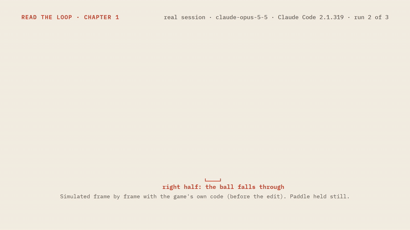

# Inside the Loop

[](media/hero.mp4)

Chapter 1 in short, made from recording 02 and the game's own code; every number in it comes from the trace.

How an AI coding agent actually works, explained on real recorded sessions.

Chapter 1, "An agent is a loop", opens with a small brick-breaker game whose ball falls through the right half of
the paddle. It then follows a real Claude Code session (recording 02, run 2 of 3) that finds and fixes the bug: the
reader plays the harness for the first round, then steps through the rest or watches it at the recorded speed. A
loop diagram, the 10-line agent loop and a context window drawn to scale move with each step. It ends with the fixed
game, made of the agent's edited file as it is.

## Run it

Open `site/index.html` (the contents) or `site/loop/index.html` (chapter 1) in a browser. There's no build step
and no server.

## Layout

| Path | What it is |
|---|---|
| `site/index.html` | Contents page: the 8 chapters, chapters 1–5 linked |
| `site/style.css` | Styles shared by every page |
| `site/lib/trace-ui.js` | Helpers any chapter can use (`window.TraceUI`): escaping, number formatting, the model's markdown, line excerpts, request/result/text cards |
| `site/loop/index.html`, `app.js` | Chapter 1 page, and its step player and live replay |
| `site/loop/copy.en.js` | Chapter 1 narration and UI labels (`window.COPY`); a translated page loads its own copy file |
| `site/context/index.html`, `app.js`, `chapter.css`, `copy.en.js` | Chapter 2 page (the context window), its figures, styles and narration |
| `site/cache/index.html`, `app.js`, `chapter.css`, `copy.en.js` | Chapter 3 page (caching), its figures, styles and narration |
| `site/compaction/index.html`, `app.js`, `chapter.css`, `copy.en.js` | Chapter 4 page (compaction), its figures, styles and narration |
| `site/tools/index.html`, `app.js`, `chapter.css`, `copy.en.js` | Chapter 5 page (tools and permissions), its figures, styles and narration |
| `site/harness-step.js`, `.css` | The "you are the harness" widget for round 1 (demo and check in `tests/`) |
| `site/data/trace-02-runK.js` | Recording 02, runs 1 to 3 (generated); the page shows run 2 and lists all three |
| `site/game/run2/before/`, `after/` | The game as given to the agent, and with the agent's recorded edits replayed (generated) |
| `data/trace-*.json` | The same traces as JSON (generated) |
| `site/data/tools-05.js`, `data/tools-05.json` | Recording 05's tool manual: its shape and sizes, with no private text (generated, `window.TOOLS`) |
| `site/data/trace-05.js`, `data/trace-05.json` | Recording 05, the session whose requests chapter 5 opens (generated) |
| `site/data/trace-01.js`, `data/trace-01.json` | Recording 01 (the shopping-cart bug of chapter 1 v1, tag `ch1-v1`) |
| `fixtures/game/` | The buggy game the agent was given in recording 02 |
| `fixtures/cart/` | The buggy project of recording 01 |
| `scripts/record.py` | Records a command's output byte for byte, with arrival times |
| `scripts/build-trace.py` | Turns a raw recording into the trace files |
| `scripts/capture-proxy.py` | A local logging proxy that saves the request bodies Claude Code sends the model, never the headers |
| `scripts/extract-tools.py` | Turns the captured request bodies into the tool manual files (`tools-05`), sizes and excerpts only |
| `tests/` | Tests for the build script (`python -m unittest discover tests`) and the widget check (`node tests/harness-step-check.js`) |
| `scripts/screenshot.js` | Screenshots of each page's states at desktop, phone and dark sizes (one entry per page); fails on console errors, horizontal overflow, a local link that doesn't resolve, or a game frame that doesn't load or take keys |
| `AGENTS.md` | Rules for coding agents working on this repo |

## Record a session

```sh
cp fixtures/cart/*.py <empty-folder>/ && cd <empty-folder>
python <repo>/scripts/record.py <recordings>/raw-NN.jsonl -- claude -p "The tests are failing. Please find the bug and fix it." \
  --output-format stream-json --verbose \
  --restricted --tools "Bash,Read,Edit,Glob,Grep" --allowedTools "Bash(python *)" Read Edit Glob Grep \
  --strict-mcp-config --setting-sources "" --permission-mode acceptEdits --no-session-persistence
cd <repo>
python scripts/build-trace.py <recordings>/raw-NN.jsonl data/trace-NN.json <empty-folder> \
  --prompt "The tests are failing. Please find the bug and fix it." --alias "~/cart" \
  --times <recordings>/raw-NN.times.json \
  --fixture fixtures/cart --files-out out/files-NN
```

Keep `<recordings>` outside the recording folder, so the agent never sees its own recording.
`record.py` writes claude's output to `raw-NN.jsonl` byte for byte and notes when each line arrived in
`raw-NN.times.json`. With `--times` the trace's `t_ms` values are those arrival times; without it they come from the
events' own timestamps (`time_source` says which). For several runs of one task, add `--run K --runs N`.
`--fixture` replays the recorded Edit and Write calls onto a copy of the fixture (`out/files-NN/before/` and
`after/`) and stops if the result doesn't match the recording folder, for example because Bash changed a file.

The raw recording isn't committed, because it holds session IDs and local details. The build script redacts the
recording folder (it becomes `--alias`) and the local user name, and changes nothing else. Before writing, it fails
if the trace still holds the recording folder, the user name, a home folder or a drive path.

Tests: `python -m unittest discover tests`.

## Rules

- Every number and every word the agent wrote or saw comes from a recording. Only the narration is written by hand.
- Show only what a recording proves. Make no claims about any vendor's internals.
